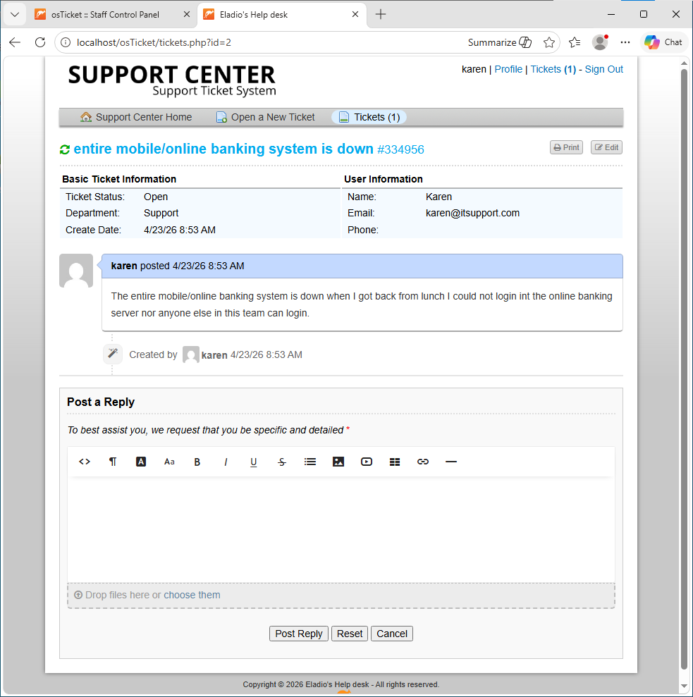
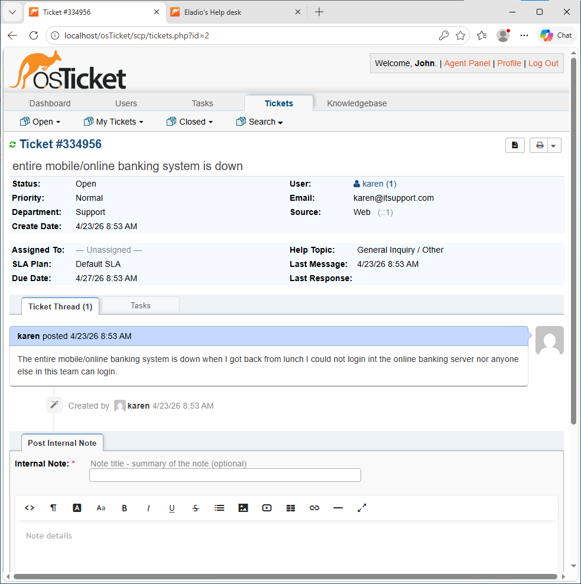
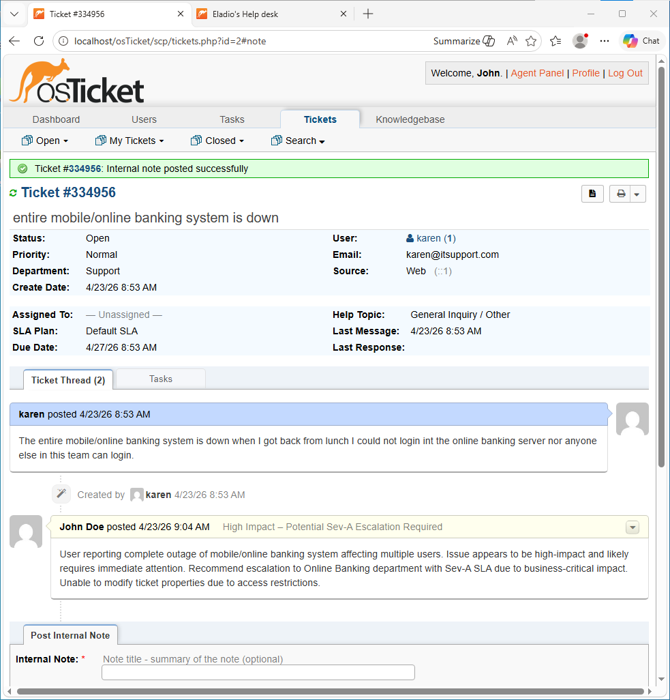
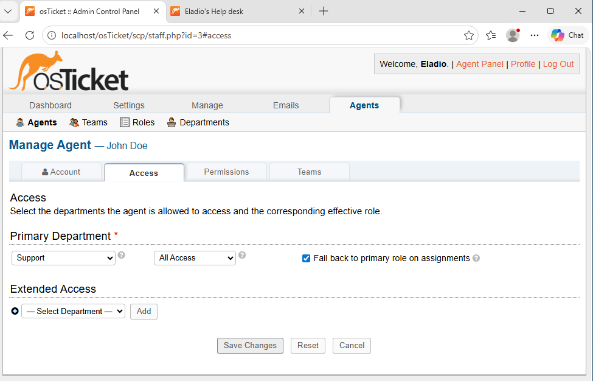
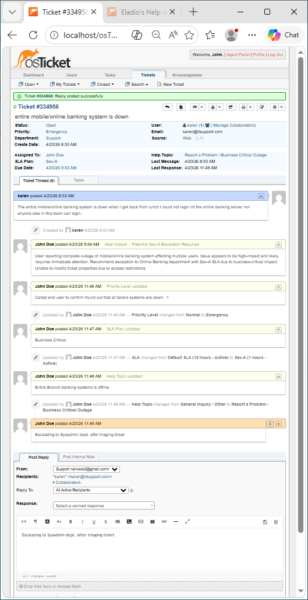
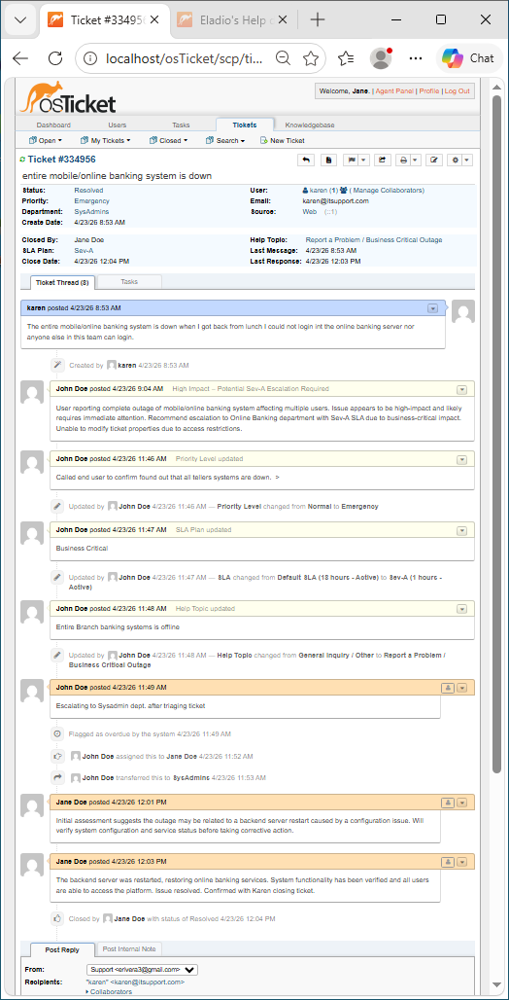

  

# osTicket Ticket Lifecycle and Escalation

**Project context:** Simulated support incident · Part 3 of the osTicket series

I used a sample outage ticket to practice intake, impact assessment, internal notes, escalation, assignment, and closure in osTicket.

## At a glance

- Identified missing priority, SLA, and routing information.
- Documented the assessment when agent permissions blocked changes.
- Used administrator-approved access changes to continue the workflow and complete the simulated ticket.

**Why it matters for IT support:** Shows how I document a problem, recognize a limit in my authority, and escalate rather than bypass controls.

[Installation lab](https://github.com/erivera3/osticket-prereqs/) · [Configuration lab](https://github.com/erivera3/post-install-config)

**Scope:** The outage and its resolution were simulated. Closing the ticket demonstrates the workflow; it does not establish that I restored a real banking or customer system. Elevated access in this exercise is not a general recommendation for handling escalation.

**SLA interpretation:** In osTicket, the plan's grace period sets when an unresolved ticket becomes overdue; it does not guarantee a first-response time or a resolution. [Official SLA documentation](https://docs.osticket.com/en/v1.16.4/Admin/Manage/SLA%20Plans.html).

[Back to my portfolio](https://github.com/erivera3)

<strong>Open the full walkthrough, screenshots, decisions, and lessons</strong>

## 📌 Context

A ticketing system does not operate in isolation. Its behavior is controlled by:

- Role-based access restrictions  
- SLA tracking  
- Ticket classification  
- Administrative control  

This simulation tested how those factors interact during a critical incident.

---

## 🧰 Technologies Used

- osTicket  
- PHP  
- MySQL  
- Web-based interface  

---

## 💻 Environment

- Local osTicket deployment  
- Admin Panel: `http://localhost/osTicket/scp/login.php`  
- End User Portal: `http://localhost/osTicket`  

---

## ⚙️ Implementation

### 1. Ticket Intake

**Problem:**  
Critical outage entered system without classification.

**Decision:**  
Simulate real intake where tickets are incomplete or unstructured.

**Result:**  
- Ticket created without SLA, priority, or routing  
- Required manual assessment  

  

---

### 2. Initial Assessment

**Problem:**  
Ticket lacked classification and routing.

**Decision:**  
Agent reviewed and identified business impact.

**Result:**  
- Recognized need for escalation  
- Identified missing SLA and priority  

  

---

### 3. Access Restriction (Workflow Blocker)

**Problem:**  
Agent lacked permission to modify ticket properties.

**Cause:**  
Role-based access restrictions prevented escalation.

**Decision:**  
Document findings using internal notes.

**Result:**  
- Ticket assessment recorded  
- No direct action possible  

  

---

### 4. Administrative Intervention

**Problem:**  
Workflow blocked due to insufficient permissions.

**Decision:**  
Administrator elevated agent access level.

**Result:**  
- Agent gained control over ticket properties  
- Workflow resumed  

  

---

### 5. Escalation and SLA Assignment

**Problem:**  
Critical issue not prioritized.

**Decision:**  
- Assign Sev-A SLA (1 hour)  
- Set priority to Emergency  
- Route to appropriate department  

**Result:**  
- Ticket escalated to reflect business impact  
- SLA target recorded for the simulated ticket  

  

---

### 6. Resolution

**Problem:**  
System outage required closure verification.

**Decision:**  
Investigate, resolve, and confirm system recovery.

**Result:**  
- Issue resolved  
- Ticket closed with full audit trail  

  

---

## 🔍 Key Failures & Constraints

### Permission Limitation
- Agent unable to modify ticket  
- Required escalation to admin  

### Missing Classification
- Ticket entered system without SLA or priority  
- Required manual correction  

### Delayed Escalation Risk
- Critical issue initially treated as normal  
- Required reassessment and escalation  

---

## 🧠 Decisions That Mattered

- Documented issue when action was blocked  
- Escalated permissions instead of bypassing controls  
- Applied SLA and priority based on impact  
- Ensured routing aligned with responsibility  

---

## 🛡️ System Understanding

- Permissions define what actions are possible  
- SLA defines urgency, not authority  
- Misconfigured roles can delay resolution  
- Administrative control directly affects workflow  
- Ticket lifecycle depends on both configuration and decisions  

---

## 📌 Key Lessons

- Access control can block or enable resolution  
- Proper classification determines response speed  
- Escalation is required when authority is limited  
- System behavior is governed by configuration  

---

## Summary

This project demonstrates how real support workflows are shaped by system constraints rather than ideal processes.

Key outcomes:

- Identified how permission limitations block action  
- Used escalation to restore workflow capability  
- Applied SLA and priority to reflect real business impact  
- Completed full ticket lifecycle with controlled resolution  

**Result:**  
A clear demonstration of how access control, escalation, and SLA policies determine whether a system can respond effectively to critical incidents.

